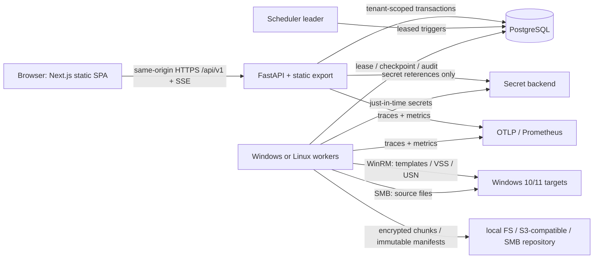

# Proposed architecture

**Status: design, not deployed.** The platform targets Windows 10/11 files and folders without an installed target agent. [PLAN](PLAN.md) defines build order; [SECURITY](SECURITY.md) defines trust boundaries.



## Runtime boundaries

- **API** validates Pydantic requests, identity/RBAC, tenant scope and mutation audit; generates OpenAPI 3.1, serves health/metrics/SSE and exported frontend. No long backup work in request handlers.
- **DB** stores definitions, leases, status/checkpoints, metadata and immutable audit/manifest records, not plaintext secrets or backup contents. Use tenant-scoped repository methods and RLS. See [ERD](ERD.md).
- **Scheduler** elects a leader; enqueues due runs once and performs housekeeping. Workers lease jobs transactionally, obey per-host/credential/global limits, heartbeat, checkpoint and reclaim expired work.
- **Connections** expose allowlisted, parameter-safe WinRM commands and mature SMB clients. Distinguish transport/auth/protocol/throttle failures. Every target call has connect/read timeouts and an overall job deadline. No arbitrary user script execution or CredSSP.
- **Workers** use scratch only for resumable staging. Windows workers may use robocopy when they can access the **snapshot view**, not merely the live share. Linux uses an explicit SMB-client strategy where a snapshot view is accessible. Topology selection is validated per host/source.
- **Storage** exposes `StorageBackend` (`local_fs`, `s3_compatible`, `smb_share`) and `CopyStrategy`, `ChangeDetector`, `SecretBackend`, `TaskHandler`, `Notifier` interfaces. Dedup/crypto are above the backend. Mirror mode remains encrypted, with different metadata layout.

## Data flow

```mermaid
sequenceDiagram
  participant U as Operator or scheduler
  participant A as API/queue
  participant W as Worker
  participant H as Windows host
  participant R as Repository
  U->>A: Trigger template (tenant, idempotency key)
  A->>A: Authorize, audit, create QUEUED instance
  W->>A: Lease and checkpoint PREFLIGHT
  W->>H: Probe WinRM/SMB, credentials, source/VSS access
  W->>H: Create VSS snapshot (NTFS default)
  W->>H: Scan snapshot; compare with baseline
  W->>R: Stage chunks and immutable candidate manifest
  W->>R: Verify hash + sample restore if configured
  W->>A: Commit manifest/refcounts and SUCCEEDED or PARTIAL
  W->>H: Delete snapshot (finally; reaper on crash)
  W->>A: Audit outcome and emit SSE
```

For **Full**, scan every selected file and establish a chain root. For **Incremental**, compare to the last successful backup of any type and record changes/deletions; replay the Full plus ordered increments to restore. For **Differential**, compare to last Full and restore with that Full plus selected Differential. Never choose an incomplete or unverified set as a baseline. [BACKUP-AND-RESTORE](BACKUP-AND-RESTORE.md) gives consistency and commit rules.

```mermaid
sequenceDiagram
  participant U as Operator
  participant A as API
  participant W as Restore worker
  participant R as Encrypted repository
  participant D as Destination
  U->>A: Select set/files/target and confirm overwrite names
  A->>A: Authorize, path-validate, audit request
  W->>R: Load verified chain and decrypt chunks
  W->>W: Resolve paths beneath scratch root; verify hashes
  W->>D: Write temporary files, apply overwrite policy, atomically replace
  W->>A: Record per-file results and audit
  A-->>U: Progress and final server-confirmed status
```

## Recovery and failure boundaries

At-least-once delivery means handler steps need stable run/source/file IDs and idempotent writes. Stage objects under attempt-specific keys; publish an immutable manifest only after full integrity verification; transactionally update refcounts/state; reclaim/reconcile stranded staging after lease expiry. Cooperative cancellation, worker crash and hard deadline must release sessions and trigger snapshot cleanup; orphan reaping separately handles abrupt termination. One failed source yields `PARTIAL` when others succeed. Retries are limited by error taxonomy and attempt policy, with poison-job quarantine; operators get host, reason and remediation. Never report success before durable commit. See [SCHEDULING-AND-WORKFLOWS](SCHEDULING-AND-WORKFLOWS.md) and [OPERATIONS](OPERATIONS.md).

## Observability

Propagate correlation ID from request through queue, worker, connector and audit row. JSON logs omit secrets/content and optionally filenames; spans cover preflight, snapshot, scan, copy, verify, index and prune. Prometheus RED + domain metrics and alert names are specified in [DEPLOYMENT](DEPLOYMENT.md).
