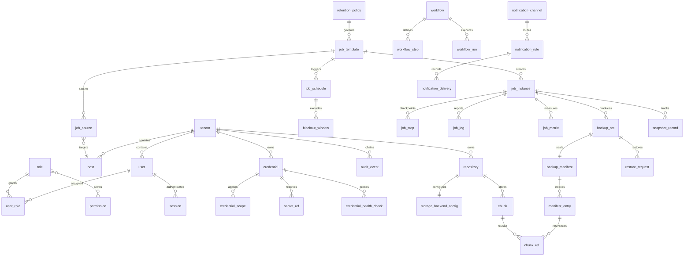

# Proposed data model

**Status: schema specification; no migration exists.** PostgreSQL 15+ with SQLAlchemy 2 async and Alembic. Every tenant-scoped table below has a non-null `tenant_id` referencing `tenant`, a tenant-inclusive unique key `(tenant_id, id)`, and tenant-inclusive FKs for links between scoped tables; repository guards and RLS require tenant context. `tenant` itself is global; `permission` can be a controlled global catalogue. Migration from empty DB and seed content are future work.

## Entity catalogue (all 43 required entities)

| Domain | Entities and principal fields (in addition to `id`, `tenant_id`, timestamps where applicable) |
| --- | --- |
| Identity | `tenant` (slug, status, key_ref, retention_defaults); `user` (identity, password_hash, state, MFA metadata); `role` (name, scope); `permission` (resource, action); `user_role` (user_id, role_id, scope_kind, scope_value); `api_key` (principal_id, key_hash, scope, expires_at, last_used_at); `session` (user_id, refresh_hash, device, idle_expires_at, absolute_expires_at, revoked_at); `auth_provider_config` (kind, public config, secret_ref, group_mapping) |
| Inventory | `host` (name, address, auth_mode, smb_only, pause, site); `host_tag` (host_id, tag); `host_capability` (host_id, name, state, checked_at) |
| Credentials | `credential` (name, kind, username, domain, notes, tags, rotation_due_at, last_used_at); `credential_scope` (credential_id, host/share/domain selectors, priority); `secret_ref` (credential_id, backend, opaque locator, version metadata); `credential_health_check` (credential_id, host_id, WinRM/SMB/Kerberos/expiry/lockout result, checked_at) |
| Storage | `repository` (name, backend_id, encryption_key_ref, dedup_enabled, capacity, status); `storage_backend_config` (kind, nonsecret settings, secret_ref) |
| Scheduling | `job_template` (name, kind, repository_id, retention_policy_id, pause, priority); `job_source` (template_id, host_id, share, patterns, overrides, credential_ref); `job_schedule` (template_id, kind, expression, timezone, catch_up, jitter, next_run_at); `blackout_window` (schedule_id or policy scope, start/end, defer_or_skip) |
| Executions | `job_instance` (template_id, trigger, status, deadline_at, attempt, lease_owner, lease_expires_at, heartbeat_at, idempotency_key, correlation_id); `job_step` (instance_id, source_id, phase, checkpoint, status); `job_log` (instance_id, level, redacted_message, occurred_at); `job_metric` (instance_id, metric, numeric_value, unit) |
| Backup | `backup_set` (instance_id, template_id, type, root_set_id, parent_set_id, verification_state, completed_at); `backup_manifest` (set_id, version, digest, sealed_at); `manifest_entry` (manifest_id, relative_path, attributes, timestamps, size, content_hash, deletion_marker); `chunk` (repository_id, digest, encoded_size, ref_count, zero_since); `chunk_ref` (entry_id, ordinal, chunk_id, offset, length); `retention_policy` (daily, weekly, monthly, yearly, min_keep, depth_warning); `snapshot_record` (host_id, job_instance_id, provider_id, created_at, deleted_at) |
| Restore/automation | `restore_request` (set_id, target, selection, overwrite_mode, actor_id, status); `workflow` (name, version, enabled); `workflow_step` (workflow_id, key, handler_type, config, edges, retry_policy); `workflow_run` (workflow_id, status, trigger, correlation_id) |
| Notifications | `notification_channel` (type, config, secret_ref); `notification_rule` (scope, event, channel_id, template); `notification_delivery` (rule_id, instance_id, attempt, status, sent_at) |
| Governance | `audit_event` (tenant_seq, actor_type/id, target_type/id, action, before/after redacted JSON, correlation_id, prev_hash, event_hash, occurred_at); `setting` (scope, key, value); `feature_flag` (key, enabled, rollout_scope); `plugin_registry` (handler_type, package, version, review_state) |

Secret-bearing columns contain **references**, never plaintext; refresh/API tokens are hashed. Credential secrets and repository KEKs must not be included in before/after audit payloads. `auth_provider_config` and backend config reference provider secrets through `secret_ref` or provider-specific opaque refs, not inline JSON.

The diagram simplifies role/permission linkage: implement an explicit tenant-scoped role-permission association or a reviewed permission array with a normalized association table, and test permission revision. All minimum entities remain required even if additional join tables are introduced.

## Constraints, indexes and immutability

- Unique `tenant.slug` globally and `(tenant_id, name)` for tenant-owned named resources where relevant; `(tenant_id, idempotency_key)` for trigger request deduplication; `(tenant_id, repository_id, digest)` for chunk reuse; `(tenant_id, manifest_id, relative_path)` for manifest entries; `(tenant_id, schedule_id, local_occurrence)` for DST dedupe.
- Index `(tenant_id, status, created_at DESC)` on instances; `(status, lease_expires_at, priority)` for reclaim/lease; `(tenant_id, next_run_at)` on schedules; `(tenant_id, occurred_at DESC)` on audit/log; `(tenant_id, host_id, completed_at DESC)` for baseline lookup. Every external FK has an index.
- Application and database permissions prohibit UPDATE/DELETE on sealed manifests/entries and existing audit events. A retained backup set points to immutable manifests; tombstones encode deletions. Chunks use transactional refcount increment/decrement under row lock; zero-ref chunks are removed only after the safety window and a reconciliation scan. Never prune the last known-good Full.
- Audit append locks a tenant-local sequence/head, writes a canonical redacted payload with `prev_hash`, computes `event_hash`, and commits in the same transaction as the mutation. Verification detects missing/reordered/edited rows; the chain is not an external notarization. Secret reads by workers/scheduler use separate audited events.
- Soft deletion is permitted only for user-facing definitions needing history; document retention by resource. Audit, manifests and referenced chunks are not soft-deleted shortcuts.

## Migration and seed sequence

1. Tenant/identity/permissions and guarded DB roles; then host/credential/secret metadata and backend configs.
2. Repository/jobs/schedules and transactional queue; then backup set/manifest/chunks; then workflows, notifications, settings and audit chain.
3. Use a dedicated migration job protected by advisory lock, with forward-compatible expand/contract changes. Validate on empty DB and an upgrade fixture.
4. Seed an explicitly labelled demo tenant, fake hosts and dashboard sample metrics **without pretending any backup succeeded**; separate seed credentials from real secrets and disable remote actions until operator setup.
