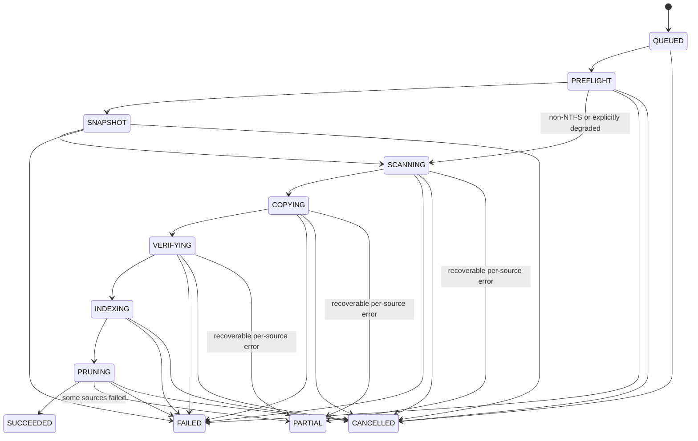

# Scheduling, queue and workflows

**Status: design only.** All instances are persisted and run at least once; idempotent handlers, not delivery guarantees, prevent duplicate side effects.

## Job state machine

`PARTIAL` and terminal transitions only follow cleanup and durable per-source outcomes; internal attempt retries keep the instance in its active phase. Every transition validates predecessor, tenant and lease, writes a checkpoint/audit event and emits an SSE update. State progression may skip `SNAPSHOT` only when policy permits and records why. `deadline_exceeded` is a terminal failure after cleanup, independent of retry allowance. Cancellation stops new work, drains current safe point, removes partial objects and closes sessions. A source-level `PARTIAL` must not mark an unverified set as a successful baseline.

## Durable scheduler and queue

- Schedule forms: cron + IANA timezone, interval, manual, chained-on-success, webhook/file-arrival/host-online event. A nonexistent DST wall time is skipped; repeated wall time fires once at earlier offset. Store local occurrence key to dedupe and show both decisions in 30-day simulation.
- Each schedule supports holiday exclusions, blackout windows (`defer` or `skip`), `skip`/`run_once`/`run_all` catch-up, and bounded random jitter. Preview uses identical expansion logic to actual enqueuing. Schedule evaluation uses a DB advisory-lock leader, durable next-run pointer and unique occurrence key.
- Postgres queue: claim due rows with `FOR UPDATE SKIP LOCKED`, heartbeat lease, checkpoint every N files or T seconds, reclaim expired leases after deadline. Per-host mutual exclusion by default, policy limits, credential/global token buckets and priority fairness ensure a slow Full cannot starve other hosts. Bound in-flight bytes and aggregate queue depth for backpressure.
- Attempts use exponential backoff with jitter and error-specific terminal/retryable rules. Repeated identical failure beyond threshold quarantines/pauses the template and alerts; kill switches at host/policy/global level block new work only. Maintenance mode drains workers. On SIGTERM stop claiming, finish or checkpoint before drain deadline; do not abandon snapshot cleanup.

## Task and workflow model

`TaskHandler` receives validated tenant context, typed input, deadline, cancellation token and restricted service interfaces; returns typed result/checkpoint. Registry loads reviewed out-of-tree packages by entry point, with plugin version/audit metadata. Scheduler, queue and state machine dispatch by handler type and do **not** require changes to add one. Prove with an external-package plugin test. Built-ins: backup, restore, allowlisted WinRM PowerShell template, reviewed local Python callable/script library, notification, delay, conditional. Arbitrary caller-supplied PowerShell is forbidden in v1.

Workflow is a versioned DAG: nodes have handler type, input, timeout, retry policy, success/failure edges and optional condition; validate cycles, dangling references, permissions and secret refs at save. A dry run validates plan and resolves safe metadata only; it does not execute side effects. A workflow run pins its definition version, is tenant-scoped, checkpoints each step and preserves partial failure detail. Chained/event triggers carry origin and idempotency key to prevent loops.

Notification rules attach to jobs/policies for success, failure, long-running or repeated failure; channels are SMTP, generic webhook, Teams, Slack. `Notifier` sends template-rendered redacted payload through a bounded, retried delivery queue with delivery records and secret refs. Failure to notify does not rewrite backup outcome. Reports aggregate success rate, duration, bytes protected, dedup, growth, failing hosts and recovery time with permission-scoped CSV/JSON export. Optional filename index is off by default; content index requires explicit admin opt-in and audited decision.
